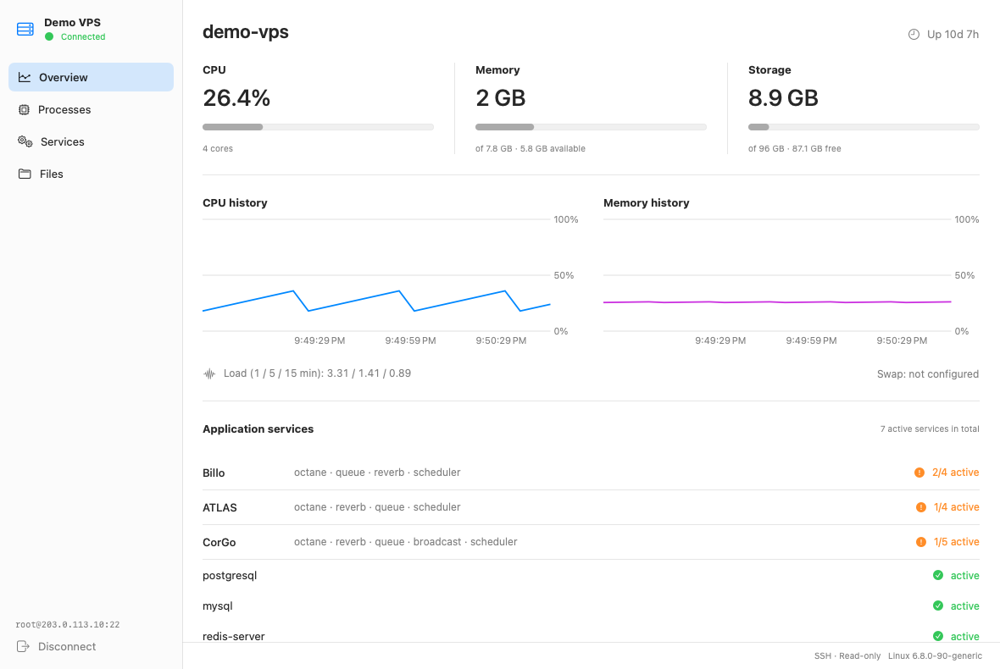
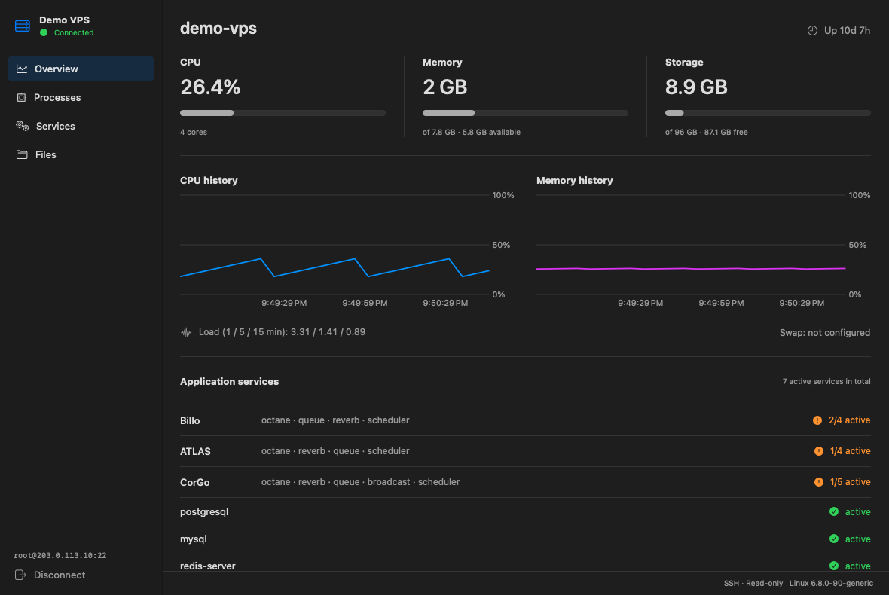
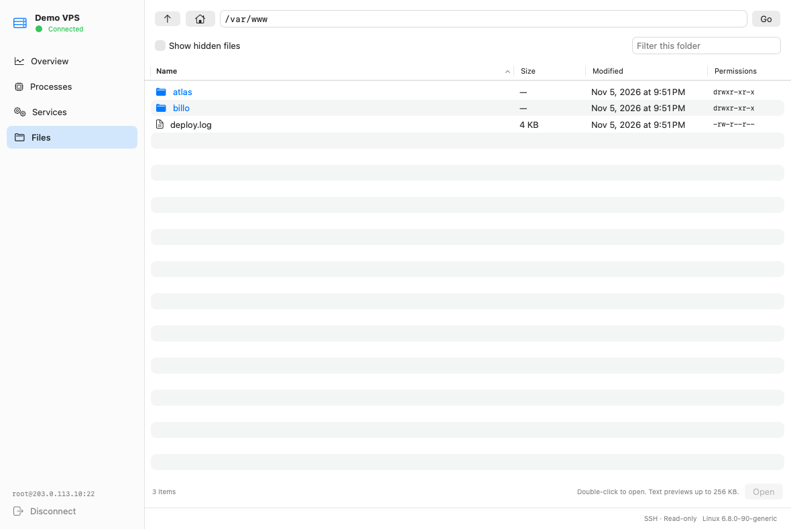

# VPS Monitor

**Activity Monitor for your Linux VPS, on your Mac.**

Keep an eye on CPU, memory, storage, processes, and services, and browse server files through SSH. VPS Monitor is a native macOS app built with SwiftUI and Swift Charts. Enter your connection details and use your existing SSH access—no monitoring agent to install on the server.

If you find it useful, **give this repository a ⭐** to help others discover it. Fork it, try it on your server, and share your improvements. Stars are appreciated, never required.



*Screenshots use demo data.*

## Features

| View | What you can do |
| --- | --- |
| **Overview** | View sampled CPU usage, load averages, RAM, swap, root filesystem storage, uptime, and resource history. |
| **Processes** | Search up to 250 processes and sort by CPU, memory, user, name, or PID. |
| **Services** | Search and filter loaded systemd services, including their active state and substate. |
| **Files** | Browse directories, show hidden files, sort columns, copy paths, and preview text files. |

- Refresh automatically every 3, 5, 10, 30, or 60 seconds (30 seconds by default). Your selection is remembered between launches. Pause monitoring or refresh immediately with **⌘R**.
- Connect using a password, default SSH keys, or an SSH agent.
- Verify the server’s SSH fingerprints before the first connection.
- Save passwords in macOS Keychain when you choose to remember them.
- Follow the system’s light or dark appearance.
- Inspect your server with read-only remote operations.

<details>
<summary>Dark appearance</summary>



</details>

<details>
<summary>Remote file browser</summary>



</details>

## Requirements

**On your Mac:** macOS 14 or later, Xcode with a Swift 6 toolchain to build the app, and Python 3 to run the Python tests. The package has no third-party dependencies.

**On your VPS:** Linux, SSH access, Python 3, systemd, and standard Linux tools including `ps`. What you can inspect depends on your SSH account’s permissions; root access is not required by the app.

## Build and run

Clone this repository and open its directory in Terminal, then run:

```sh
zsh scripts/build.sh
open 'dist/VPS Monitor.app'
```

The build script compiles the app and password helper, creates the app icon, packages the resources, and signs the bundle locally. The resulting app is at `dist/VPS Monitor.app`. You can also open `Package.swift` in Xcode to explore the project.

Builds use ad hoc signing. A Developer ID signing and notarization workflow is not included, and prebuilt downloads are not currently documented here.

## Connect to your server

1. Enter a server name, IP address or hostname, SSH port, and username.
2. Enter your SSH password, or leave it empty to use default SSH keys or an SSH agent.
3. Choose whether to remember the password in Keychain, then click **Connect to Server**.
4. Compare the displayed host fingerprints with the ones in your VPS provider’s console, then choose **Trust and Connect**.

For example, this command in your provider’s server console shows the ED25519 host fingerprint:

```sh
ssh-keygen -l -E sha256 -f /etc/ssh/ssh_host_ed25519_key.pub
```

Once connected, use the sidebar to switch between Overview, Processes, Services, and Files. Double-click a folder to open it or a regular text file to preview it.

## Credentials and server trust

The app stores the server profile in local UserDefaults and its trusted host keys in `~/Library/Application Support/VPSMonitor/`. Passwords are stored separately in macOS Keychain and are never included in the saved profile or passed as command-line arguments.

OpenSSH uses a separate helper to retrieve the password from Keychain. Even with **Remember password** off, a Keychain item is needed during the session. It is removed on disconnect, after a failed connection, or when an established session ends through normal app termination. A crash or force-quit can leave that item behind; reconnecting without a password or choosing **Forget saved server** removes the current profile’s credential. Keychain may request access on first use or after rebuilding.

Strict host checking stays enabled. If a host key changes, independently verify the change through your provider before forgetting the saved server and reconnecting. File operations, resource collection, and service queries do not modify the VPS.

## Current scope

This is an early version. These limits are useful to know before trying it:

- **One saved server at a time.** There is no multi-server dashboard yet.
- **SSH configuration:** custom `~/.ssh/config` entries and interactive MFA are not supported.
- **Measurements:** storage covers `/` only. Process CPU is the lifetime average reported by `ps` and can exceed 100% across multiple cores. Overall CPU is sampled between refreshes.
- **Service summaries:** the Overview currently includes fixed Billo, ATLAS, and CorGo application presets, plus PostgreSQL, MySQL, and Redis. The Services view lists loaded systemd services on any supported server. Configurable application groups are a useful contribution opportunity.
- **Service states:** inactive does not always mean broken; `active (exited)` does not mean a process is running.
- **Files:** text previews are limited to 256 KB, and folders show at most 10,000 entries. Symlinks and special files are listed but not followed for previews. File editing, transfers, and deletion are not implemented.
- **Monitoring:** each read opens a short SSH connection. History keeps up to 120 samples in memory and resets on reconnect. Refresh failures retain the last readings and display a stale-data message.
- **Server actions:** restarting services and terminating processes are not implemented.

## Development and tests

```sh
swift test --disable-sandbox
python3 -m unittest discover -s Tests -p 'test_*.py'
```

Swift tests cover connection validation, shell quoting, host-file path parsing, subprocess behavior, service grouping, and file sorting. Python tests cover the Linux collector and file operations using fixtures and temporary files. The visual test is opt-in; see [CONTRIBUTING.md](CONTRIBUTING.md) for capture instructions and manual connection checks.

## Contributing

Bug reports, documentation fixes, accessibility improvements, and pull requests are welcome. You do not need to work on a large feature to contribute.

Read [CONTRIBUTING.md](CONTRIBUTING.md) for setup, project structure, testing, and the pull request workflow. If you use or fork the app, a star or a link back helps people find the original project.

## License

Licensed under the [MIT License](LICENSE). Copyright © 2026 mktz.
